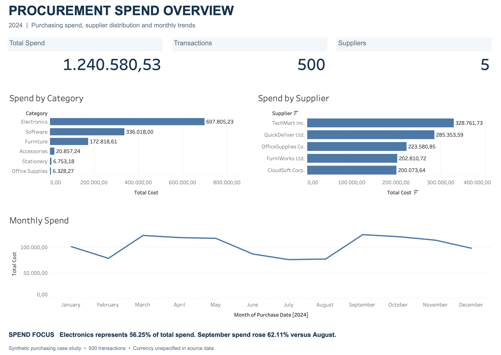

# Procurement Spend Analysis

A procurement spending review using Excel, SQL, and Tableau. This case study uses synthetic purchasing data for 2024.

The analysis looks at where spending is concentrated, how it is distributed across suppliers, and what changed between August and September.

## Dashboard

[View the interactive dashboard on Tableau Public](https://public.tableau.com/views/procurement_spend_overview/ProcurementSpendOverview)



[Download the Tableau workbook](procurement_spend_overview.twbx). Click a category or supplier bar to filter the dashboard. Click the selected bar again to clear it.

The full dataset contains **500 transactions**, **5 suppliers**, and **1,240,580.53 in total spend**. The source does not specify a currency. The screenshot uses Indonesian number formatting.

## Main findings

### Laptops account for most Electronics spending

Electronics accounts for **56.25% of total spend**. Within Electronics, laptops account for **67.7%**, with **472,284.81 spent on 532 units**.

A useful next step is to check whether those purchases matched equipment needs and whether existing laptops were being used effectively. A large spending share alone does not show waste.

### TechMart receives the largest share of supplier spend

Purchases from TechMart total **328,761.73**, or **26.50% of total spend**.

To assess supplier dependence, the procurement team would need to check whether critical items have alternative suppliers, how long switching would take, and how an interruption would affect operations.

### Electronics drives the September increase

Spend rose from **77,222.97 in August** to **125,187.25 in September**, an increase of **62.11%**. Electronics contributed **30,391.51**, or **63.36% of the net increase**.

The next review should separate three possible drivers:

- **Quantity:** Did purchasing volumes increase? What need or urgency justified the additional units?
- **Price:** Did prices rise for comparable items? Was the change limited to one supplier or seen across suppliers?
- **Product mix:** Did purchases shift toward more expensive items or specifications needed for a particular purpose?

These are follow-up questions. The analysis identifies the spending change but does not establish its business cause.

## Methods and checks

- **Excel:** prepared the import, checked data types and duplicate IDs, and built PivotTables, spend shares, weighted average unit prices, and monthly changes.
- **SQL (DuckDB):** reproduced the category, supplier, item, and monthly summaries and reconciled them with Excel.
- **Tableau:** built the overview and category and supplier filters.

Checks found 500 unique transaction IDs, 500 numeric total costs, and 500 numeric purchase dates. No transaction differed from `Quantity × UnitPrice` by more than 0.01. Excel and SQL returned the same total spend of **1,240,580.53**.

## Data and limitations

Source: [Company Purchasing Dataset by Shahriar Kabir](https://www.kaggle.com/datasets/shahriarkabir/company-purchasing-dataset). See [source notes](dataset_alternative/SOURCE.md) for the working file format and publisher-reported license.

The records are synthetic. They do not include budgets, detailed product specifications, purchase justifications, inventory, utilization, or supplier service performance. Items with the same name may have different specifications. One year of data also cannot establish recurring annual seasonality. No savings estimate is claimed.

## Files and usage

| File | Contents |
| --- | --- |
| [Excel workbook](dataset_alternative/procurement_analysis.xlsx) | Data checks, PivotTables, calculations, and findings |
| [Working CSV](dataset_alternative/spend_analysis_dataset.csv) | 500 purchasing records |
| [SQL script](sql/procurement_spend_analysis.sql) | Import settings and analysis queries |
| [Tableau workbook](procurement_spend_overview.twbx) | Interactive dashboard with packaged data |

Open the Excel workbook to inspect the calculations or the Tableau workbook to explore the dashboard.

To run SQL locally, install DuckDB and execute this from the repository root:

```sh
duckdb < sql/procurement_spend_analysis.sql
```

For the DuckDB Web Shell, import the CSV and change the import path in the script to `spend_analysis_dataset.csv`. The script handles the working CSV's semicolon delimiter, decimal commas, and DD/MM/YY dates.
